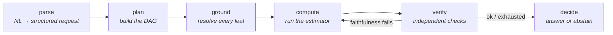

# numbers with receipts

*An agent that refuses to make up numbers. Every value it reports carries a receipt; when it can't ground an answer, it abstains instead of inventing one.*

## Thesis

Ask a language model a quantitative question and it will always give you a number. The failure is that **there's no way to tell a computed number from a hallucinated one.** 
This project makes that distinction clearer. Every number in the system is a `Quantity` that must carry its **provenance**:

| Provenance | Meaning | Requirement |
|------------|---------|-------------|
| `UserGiven` | the user supplied it | — |
| `Constant`  | a sourced value | must name its **source** (a citation) |
| `Derived`   | computed | must name its **method** and its **input** quantities |
| `Unknown`   | not grounded | must name a **reason** and **cannot carry a value** |


An `Answer` is likewise **answered-with-a-grounded-result** or **abstained-with-a-reason**. A hallucinated answer isn't caught at runtime; it **fails to typecheck**. See [`groundwork/models.py`](groundwork/models.py) for the five invariants.

## How it works

A [LangGraph](https://github.com/langchain-ai/langgraph) agent runs six typed nodes. The number is built up a leaf at a time, each leaf grounded before anything is computed, and the result is re-checked.



- **parse** — an LLM turns the question into a structured request: the target, the numbers the user gave, the algorithm and key size, the hardware. No LLM available, or an unreadable reply? It falls back to a regex parser, and the `Answer` records which reader ran (`meta.parser`).
- **plan** — picks a recipe and lays out the computation DAG, tagging each leaf as *user input*, *published workload* or *sourced constant*. For estimator questions it also fixes the machine: the one the user named, or a declared default when they named none; never a silent substitute.
- **ground** — resolves the leaves. A missing required input becomes `Unknown`.
- **compute** — runs the domain method (analytic formula or resource estimator) and tags the result `Derived`.
- **verify** — independent checks (below). Advisory checks annotate; blocking checks force an abstention, after one recompute if faithfulness failed.
- **decide** — assembles the `Derivation` and emits an `answered` or `abstained` `Answer`.

## Domain: quantum resource estimation

The spine is domain-agnostic; the wired-up domain is **fault-tolerant quantum resource estimation**; "how many physical qubits / how long to run algorithm X on hardware Y?" It's a good stress test: the numbers span many orders of magnitude, the literature disagrees and a plausible-looking wrong answer is easy to produce.

Grounding sources, each receipted:

- **Analytic QEC formulas** — surface-code logical error rate `P_L ≈ a·(p/p_th)^((d+1)/2)`, required code distance (inverted and forward-verified), the `2d²` footprint, cycle time — each `code_ref`'d to Fowler et al. (2012) / the Azure QRE methodology.
- **Azure Quantum Resource Estimator** (`qsharp.estimate`) — full physical estimates from logical counts, run locally.
- **Published workloads** — logical qubit / Toffoli counts for named algorithms (e.g. RSA-2048 from Gidney 2025 and Gidney–Ekerå 2019), stored as `Constant`s with their citations and matched by algorithm *and* key size: RSA-4096 is refused, not answered with RSA-2048's counts. Toffolis enter Azure through the `CczCount` slot (a Toffoli is a CCZ up to Hadamards).
- **Cross-method check** — [Qualtran](https://github.com/quantumlib/Qualtran) as a second, independent estimator; it flags a disagreement above 2× in physical qubits. Advisory: at the code distance Azure picks, Qualtran's model misses its own error target, so its count is a lower bound.


## Verification layer

Grounding says a number *has* a source. Verification asks whether it's *right*. Each check is a `Check` with a severity ([`groundwork/verify.py`](groundwork/verify.py)):

| Check | Asks | Severity |
|-------|------|----------|
| **given fidelity** | read-back: does every number recorded as *given by the user* appear in the question? Own number reader (`0.1%`, `10^-3`, `10⁻³`, `one in a thousand`), independent of the parser it audits | blocking |
| **faithfulness** | re-execute the derivation — does it reproduce the stated value? (relative tolerance) | blocking |
| **dimensional** | do the units match the expected dimension? (via [Pint](https://pint.readthedocs.io)) | advisory |
| **magnitude** | is the value inside a physically plausible band? | advisory |
| **cross-method** | does an independent estimator (Qualtran) agree within tolerance? | advisory |

A failed **blocking** check ends in an abstention that says why; a failed faithfulness check gets one recompute first.

## Quickstart 

```bash
git clone https://github.com/doukhouhajar/numbers-with-receipts.git
cd numbers-with-receipts
python -m venv .venv && source .venv/bin/activate
pip install -e ".[dev]"     
cp .env.example .env           
python demo.py                                  
python demo.py "How many physical qubits to factor RSA-2048?"
python demo.py --json "..."                     
python demo.py --no-llm "..."                   # regex reader only
```

With an empty `.env` the agent still runs: the parser falls back to regex and tracing is disabled. To get the most out of it:

- **LLM parsing** — `LLM_PROVIDER=openrouter` with `OPENROUTER_API_KEY` and `GROUNDWORK_MODEL` (e.g. `meta-llama/llama-3.3-70b-instruct`), `LLM_PROVIDER=ollama` with a local model (`ollama pull llama3.1:8b`), or `LLM_PROVIDER=openai-compatible` pointed at any OpenAI-style endpoint (vLLM, a hosted API, …). See `.env.example`.
- **Sandboxed execution** — an `E2B_API_KEY` ([e2b.dev](https://e2b.dev)) for the code-execution tool.
- **Tracing** — Langfuse keys to get one span per node.


## HTTP API

```bash
uvicorn groundwork.api:app --reload
```
- `POST /estimate` — `{"question": "..."}` → a structured `Answer` (result + full derivation + checks)
- `GET  /health` — liveness
- `GET  /docs` — OpenAPI UI

## Evals

An [Inspect](https://inspect.aisi.org.uk/) suite in [`evals/`](evals/). The model under test is Inspect's: the agent takes any `prompt → text` function, so every model call it makes is logged with its raw reply and tokens.

| File | Role |
|------|------|
| `oracle.py` | ground truth, written **without importing `groundwork`**: code distances found by search, not by inverting the formula |
| `make_dataset.py` | builds `datasets/receipts_v2.jsonl`: 100 questions in 8 families |
| `solvers.py` | the systems under test |
| `scorers.py` | one question per scorer |
| `tasks.py` | the `receipts` and `mutation` tasks |
| `run_mutations.py` | plants one fault at a time and records which check fires |
| `analyze.py` | results table: clustered 95% intervals, paired exact McNemar tests |

| Family | Probes | Expected |
|--------|--------|----------|
| F1 code distance (20) | the core computation, three phrasings | answer, exact |
| F2 logical error rate (10) | the second analytic recipe | answer, ±5% |
| F3 missing inputs (12) | underspecified questions | abstain |
| F4 notation (20) | `0.1%`, `10^-3`, `10⁻³`, `one in a thousand` | answer, exact |
| F5 physics traps (10) | at or above threshold, negative, even distance | abstain |
| F6 workloads (12) | RSA-2048 against other key sizes and algorithms | answer within a plausibility band / abstain |
| F7 named hardware (8) | Majorana, Floquet, µs gates, error budget | honor it or abstain |
| F8 distractors (8) | irrelevant numbers around the relevant ones | answer, exact |

Four systems: `regex` (the agent, no model), `groundwork` (the agent, a model in the parse seat), `bare` (the model alone, given the same formula) and `bare_abstain` (bare + "abstain rather than estimate"). Every sample lands in one of six cells: *correct, wrong, over-abstain, proper abstain, fabricated, error*. Three more scorers read the receipts: **receipt fidelity** (is each *given by user* number one the user wrote?), **parse path** (which reader actually ran?) and **assumption fidelity** (did the estimate run on the machine the user named?).

```bash
pytest -q                                                    # includes the eval's own tests
inspect eval evals/tasks.py@receipts -T system=regex --model mockllm/model
inspect eval evals/tasks.py@receipts -T system=groundwork --model openrouter/meta-llama/llama-3.3-70b-instruct --epochs 3
python evals/run_mutations.py
python evals/analyze.py logs/before logs/after
```

`evals/eval.py` is the original 16-question harness

Hallucination is bounded by construction: an `answered` `Answer` with an ungrounded result cannot be built. A **mis-grounded** one can: a receipt that says *given by user* for a number the user never wrote. The evals measure both.

## Results

Three models through [OpenRouter](https://openrouter.ai): Llama 3.1 8B, Llama 3.3 70B, Claude Haiku 5.5. Temperature 0, three epochs, 100 questions (92 for the bare systems, which skip F7). *Right behaviour* = a correct answer or a proper abstention; ± is a 95% interval clustered by base question.

| Right behaviour | Llama 3.1 8B | Llama 3.3 70B | Claude Haiku 5.5 |
|---|---|---|---|
| model alone | 0.07 ± 0.04 | 0.36 ± 0.08 | 0.78 ± 0.09 |
| model + "abstain rather than estimate" | 0.21 ± 0.07 | 0.43 ± 0.11 | 0.96 ± 0.05 |
| Groundwork v1 | 0.86 ± 0.07 | 0.86 ± 0.07 | 0.87 ± 0.07 |
| **Groundwork v2** | **0.88 ± 0.07** | **0.99 ± 0.02** | **0.99 ± 0.02** |

| Fabricated (of should-abstain) | Llama 3.1 8B | Llama 3.3 70B | Claude Haiku 5.5 |
|---|---|---|---|
| model alone | 0.69 | 0.49 | 0.68 |
| model + "abstain rather than estimate" | 0.50 | 0.19 | 0.00 |
| Groundwork v1 | 0.17 | 0.20 | 0.19 |
| **Groundwork v2** | **0.00** | **0.00** | **0.00** |

The regex reader alone: 0.54 (v1) → 0.85 (v2).

Paired, on the same items (exact McNemar; an item counts as right if it was right in most epochs):

- **v2 vs v1:** Haiku 12 items better, 0 worse (p = 0.0005); 70B 13–0 (p = 0.0002); 8B 11–9 (p = 0.82).
- **v2 vs the same model told to abstain:** 8B 70–2 (p = 1e-18); 70B 52–0 (p = 4e-16); Haiku 4–0 (p = 0.125, not significant).

What the numbers say:

- **The scaffold makes model size matter less:** The arithmetic lives in code. Alone, Llama 3.1 8B got 4 of 60 canonical code distances right with the formula in its prompt; inside Groundwork, 0.93.
- **For a capable model, one sentence gets close:** Haiku told to abstain reaches 0.96, and Groundwork's lead over it (4 items) is not significant. What Groundwork adds there is the receipt, the arithmetic done in code and the machine the user named: none of which a bare answer can be checked for.
- **The read-back check turns misreadings into refusals; it does not make a reader read better:** With v2's larger parse schema, Llama 3.1 8B forged more receipts (0.04 → 0.10, mostly a target of 1e-12 read as 1e-9). Almost all were caught: fabricated 0.17 → 0.00, *forged and answered* 0.03 → 0.01, over-abstention 0.01 → 0.16. The larger schema coincides with the extra misreads; it was not tested as their cause.

Known limits:

- **Read-back checks presence, not position:** One 8B misread survived: `0.0001%` read as 1e-4, a number the same question also contains, as "one in ten thousand". A swap of two user numbers passes too (mutation table below).
- **F7-05 is an eval-label bug, not an agent bug:** All three models ran it on the µs-gate machine it names; Azure estimates 3.4 × 10⁸ s (≈ 10.8 years), outside a runtime band of [10², 10⁷] s calibrated to the default machine. Assumption fidelity: *substituted* 0.00 for all three. Left unfixed in the tables above.

### Do the checks catch anything?

Mutation testing: one fault at a time, on the 34 answerable F1, F2 and F6 rows, with a scripted perfect reader so each fault is isolated.

| Fault | Where it lives | Caught, v1 → v2 | By |
|---|---|---|---|
| published Toffoli count ×1000 | a receipted constant | 0 → 0 of 4 | nothing |
| Toffolis in the other estimator slot | estimator input | 0 → 0 of 4 | nothing |
| formula returns d + 2 | `domain.py` | 0 → 0 of 20 | nothing: faithfulness re-runs the same faulty function |
| prefactor 0.1 instead of 0.03 | `domain.py` | 0 → 0 of 30 | nothing |
| result altered after compute | between compute and verify | 27 → 30 of 30 | faithfulness (v1's absolute tolerance missed three small P_L) |
| runtime left in nanoseconds | estimator output | 2 → 2 of 2 | magnitude band |
| reader swaps the two user numbers | parser | 30 → 30 of 30 | magnitude or threshold, by luck: read-back can't see a swap |
| reader ignores `%` | parser | 30 → 30 of 30 | threshold by luck (v1); read-back by design (v2) |

**No check inside the agent can see a wrong `domain.py`:** Every check trusts it; only the independent oracle caught those four faults. Two real errors of that kind sat in v1's hand-written `domain.py` and are fixed in v2: Toffolis sent as T gates, which understated runtime about 3× (RSA-2048 on the default machine: 62.8 h, not 20.9 h), and a Gidney–Ekerå 2019 Toffoli count off by 1000×. Who writes the first receipt is still an open question.


## License

MIT
